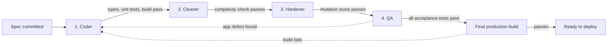

# Event Registration Live Tracker

A simple web dashboard for the Events Team. Open one link at any time and see:

- **Registrations by status**: Accepted, Pending and Cancelled
- **Progress against target** for every event
- **Which events need attention right now**, with the most urgent first

Every weekday morning, a short summary of events that are behind target is also posted to the team's Slack channel.

> **Contents:** [1. Overview](#1-overview) · [2. What the data showed](#2-what-the-data-showed) · [3. What was built](#3-what-was-built) · [4. How data stays up to date](#4-how-data-stays-up-to-date) · [5. How it was built: the agent harness](#5-how-it-was-built-the-ai-agent-harness) · [6. Tests](#6-tests) · [7. Failure points](#7-failure-points-and-safeguards) · [8. Trade-offs](#8-known-trade-offs) · [9. Future improvements](#9-future-improvements) · [10. Running it](#10-running-it-locally) · [11. Open items](#11-open-items-engineering-tracker)

---

## 1. Overview

To keep hosting free and maintenance close to zero, the tracker is:

- **A static website** (React + TypeScript, built with Vite) hosted on Vercel. There is no server or database to look after. The browser loads two data files and does the counting itself.
- **A scheduled GitHub Action** (`.github/workflows/morning-alert.yml`) that runs `script/daily-digest.ts` every weekday morning and posts a summary to Slack through the `SLACK_WEBHOOK` secret.

The dashboard and the morning digest share the same code for reading, cleaning and counting registrations. That means a registration is never counted differently in the two places.

---

## 2. What the data showed

Before building anything, I audited the two data files, `public/events.json` (the nightly event schedule) and `public/registrations.csv` (the live registration export). These are the problems I found that affect headcount accuracy.

### A. Data problems

1. **Only 3 of 8 events have live registrations.**
   - `events.json` lists **8 events**. `registrations.csv` (145 rows) covers only **3** of them: `E101`, `E114` and `E125`.
   - The other 5 (`E126`, `E130`, `E141`, `E150`, `E155`) only have a nightly total. They have no Accepted, Pending or Cancelled breakdown.

2. **10 duplicate form submissions.**
   - 10 people were submitted twice, with the same event, name, mobile number and timestamp. For example, `R1012` and `R1312` are both Arjun Nguyen, and `R1040` and `R1240` are both Sarah Smith (with different capitalisation).
   - **These are not duplicates:** Daniel Khan's two `E101` registrations (`R1072` and `R1082`) have different timestamps and different mobile numbers. They could be a re-registration or two different people, so both are kept.

3. **Messy contact details and missing values.**
   - 6 rows have no email address. About 8 rows write `@` as `[at]`, and about 6 are missing the end of the domain (for example `grace.tran@harbourins`).
   - Event `E155` has `current_registrations: null`, so no registration count was reported at all.

4. **Event names instead of event IDs.**
   - The CSV's `event` column holds text such as `"E125 Identity Leaders Roundtable SYD"`, while `events.json` uses just the ID, `"E125"`.

5. **A mix of past and upcoming events.**
   - On the reference date of `2026-11-16`, `E114` (10 Nov) and `E155` (12 Nov) have already happened. Four events (`E125`, `E101`, `E126`, `E130`) are only 2–3 days away.

### B. Rules I chose

| Decision | Rule | Why |
| --- | --- | --- |
| **Which file wins** | If an event has rows in `registrations.csv`, those live rows are used. Otherwise the tracker falls back to the nightly total in `events.json`. | `events.json` is last night's count. The CSV is the live export. |
| **What counts toward the target** | Only **Accepted** registrations count. **Pending** is shown separately as possible extra seats. **Cancelled** is not counted. | Venue planning needs the confirmed headcount. Pending sign-ups still need someone to approve them. |
| **Missing breakdowns** | For events with only a nightly total, the card says the breakdown is unavailable and shows the nightly count. It never shows `0 Pending` or `0 Cancelled`. | Showing `0` when there's no data would make coordinators think there are no cancellations or pending approvals. |
| **Duplicates** | Rows with the same event, name, mobile number (in a standard format) and timestamp are counted once, by default. A switch on the dashboard shows the raw count instead. | Stops double-clicks from inflating seat numbers, without hiding the underlying data problem. |
| **Any number of events** | Every count, card and alert works through whatever events are in the data files. No event IDs are hard-coded. | Events come and go all the time. |

---

## 3. What was built

Every feature traces back to a written specification in `specs/features/`. Each spec is a plain-English description of how the feature should behave (the "Gherkin" format). The specs were written by a person, and the AI agents are not allowed to change them.

| Spec file | What it covers |
| --- | --- |
| `data_ingest_deduplicate_reconcile.feature` | Reading both files, removing duplicates, choosing which file wins |
| `target_progress_needs_attention.feature` | Progress against target and the "Needs Attention" labels |
| `non_technical_live_dashboard_experience.feature` | A dashboard layout that non-technical staff can read at a glance |
| `live_auto_sync_with_coordinator_control.feature` | Auto-refresh, manual CSV upload and filter tabs |
| `automated_weekday_morning_digest.feature` | The weekday morning Slack summary |

### Core: reconciling the data and flagging events

- **Matching event IDs:** the `E###` code at the start of each CSV `event` value is pulled out and matched to `events.json`. Rows are counted by status. When an event has no live rows, the nightly total is used. If that is also missing (`null`), the event shows **0** with a *"No registration data reported"* label.
- **Removing duplicates:** names are compared ignoring capitalisation and extra spaces. Australian mobile numbers are converted to one format first (`+61 4xx…` and `4xxxxxxxx` both become `04xxxxxxxx`). This removes the 10 duplicate submissions and keeps Daniel Khan's two separate registrations.
- **Status labels on the dashboard:** each event card gets one label, checked in this order:

  | Label | Colour | Rule |
  | --- | --- | --- |
  | **Completed** | Grey | The event date has passed |
  | **Target Met** | Green | 100% or more of the target is confirmed |
  | **Needs Attention (Urgent)** | Red | 3 days or fewer away **and** under 70% of target |
  | **Needs Attention (Behind)** | Orange | 7 days or fewer away, but not Urgent |
  | **On Track** | Blue | Everything else (more than 7 days away and under target) |

  On the reference date of 2026-11-16, these rules give:
  - **Urgent:** E130 (16%), E126 (30%) and E101 (60%)
  - **Behind:** E125 (72%)
  - **Target Met:** E141 (103%)
  - **On Track:** E150 (13%, 100 days out)
  - **Completed:** E114 and E155

- **Dashboard layout:**
  - Four summary tiles across the top: Upcoming Confirmed Seats, Events Needing Attention, Pending Review and Duplicates.
  - A red **Action Required** box listing every event that needs attention.
  - Event cards sorted by urgency. Each card has a progress bar (*"36 of 60 target (60%)"*), the exact number of seats still needed, and the status breakdown.

### Live updates and coordinator controls

- **Refresh every 60 seconds:** the browser downloads both data files again every 60 seconds. Each request has a unique code added to the web address so the browser can't show an old saved copy. The header shows when the data was *"Last synced"*.
- **Duplicates switch:** untick *"Remove duplicate submissions"* to compare the cleaned count (**135**) with the raw CSV rows (**145**).
- **Upload New CSV:** a coordinator can pick a freshly downloaded `.csv` file and see the new numbers straight away, in their browser only. Auto-refresh pauses while an uploaded file is on screen, so it isn't overwritten. The header shows the file name.
- **Filter tabs:** **All Events**, **Needs Attention**, **Live CSV Tracked** and **Completed**.

### Weekday morning Slack digest

- **Shared code:** `script/daily-digest.ts` uses the same reading, duplicate-removal and counting code as the dashboard.
- **Schedule:** the GitHub Action runs at `0 21 * * 0-4` (UTC). That is **8:00 AM Monday–Friday Sydney time during daylight saving** (October–April). It can also be started by hand from the GitHub Actions tab.
- **What it posts:** one message listing every upcoming event **within the next 10 days that is under 85% of target**, soonest first. Each line shows the event's name, city, days remaining, confirmed vs. target, and pending count. If nothing is behind, it posts an all-clear message.
- **Note:** the digest's "behind" rule (10 days, 85%) is not the same as the dashboard's labels (3 and 7 days). This is deliberate, because each follows its own spec, and the specs are the source of truth. The digest can therefore mention an event the dashboard shows as On Track, and the reverse.

---

## 4. How data stays up to date

1. **Automatic refresh (main path):** when `public/registrations.csv` or `public/events.json` is updated and redeployed, every open dashboard tab picks up the change within **60 seconds**.
2. **Manual upload (no IT needed):** if a coordinator downloads a fresh CSV in the middle of the day, they can click **Upload New CSV** to see it immediately. This only affects their own browser.
3. **Morning push:** at 8:00 AM Sydney time each weekday, GitHub Actions runs the digest on the latest data files in the repository and posts the result to Slack.

---

## 5. How it was built: the AI agent harness

Most of the application code was written by AI coding agents (Claude). They were directed by a program in this repository, `scripts/harness.ts`. Think of it as an assembly line with an inspector at every station. Each AI worker has one job. The inspection at each station is an automated test that either passes or fails, not an opinion. Work only moves to the next station once it passes.

### How the workflow starts

1. A person writes or updates a spec in `specs/features/` and commits it to Git.
2. A Git hook (`.git/hooks/post-commit`) sees that a spec changed and automatically starts the harness for that spec:
   ```
   npm run gauntlet -- --spec specs/features/<spec>.feature
   ```
3. The harness first locks the spec by committing it as the agreed baseline and recording its fingerprint (a SHA-256 hash).

It can also be started by hand. One or more stages can be run on their own with `--stage`:

```
npm run gauntlet -- --spec specs/features/<spec>.feature --stage qa
npm run gauntlet -- --spec specs/features/<spec>.feature --stage cleaner,hardener --no-commit
```

`--stage` only decides where the **first** pass starts. If that pass sends work back to the Coder (see below), the rework always runs the full chain.

### The four stages



| Stage | The agent's job | The automated check it must pass | The agent may only change | Commands the agent may run |
| --- | --- | --- | --- | --- |
| **1. Coder** | Write the feature and its unit tests, and fix defects sent back to it | `npm run gate:coder`: type check, every unit test and a production build | `src/` | `typecheck`, `test:unit`, `gate:coder` |
| **2. Cleaner** | Simplify code that is complex and poorly tested | `npm run gate:cleaner`: type check, plus every function's CRAP score is 7 or less (`crap4ts`). The score combines how complex a function is with how well it is tested. | `src/` | `typecheck`, `test:unit`, `test:crap`, `gate:cleaner` |
| **3. Hardener** | Make the tests stricter | `npm run gate:hardener`: type check, plus at least 80% of deliberately planted bugs are caught by the tests (Stryker mutation testing) | Unit test files only | `typecheck`, `test:unit`, `test:mutation`, `gate:hardener` |
| **4. QA** | Write the acceptance test steps, and report application bugs | `npm run gate:qa`: **every scenario in every spec** passes in a real Chrome browser (Cucumber + Playwright), so it doubles as a regression test | `tests/` (plus its defect report) | `test:bdd`, `gate:qa` |
| **Final** | (no agent) | `npm run gate:final`: the production website builds cleanly | n/a | n/a |

**Every check and every agent command is an npm script in `package.json`.** That gives three guarantees:

- **The checks can't be changed by an agent,** because no agent is allowed to edit `package.json`.
- **An agent can check its own work exactly as the harness will judge it,** because it may run its own `gate:` script.
- **You can run any stage's check by hand,** for example `npm run gate:qa`.

Some commands accept extra arguments to narrow a run, for example `npm run test:unit -- src/services/dedupe.test.ts` or `npm run test:mutation -- --mutate src/services/dedupe.ts`.

After each stage passes, the harness saves **only the files that stage changed** as its own Git commit (for example `feat(coder): …` and `test(qa): …`). Any other uncommitted work in your folder is left alone. That gives a clear history of which stage changed what.

### Sending work back to the Coder (rework cycles)

Sometimes a later stage finds a problem that belongs to the Coder:

- **QA finds an application bug.** QA isn't allowed to change app code, so it writes a defect report (which scenario failed, expected vs. actual, the files it suspects) and stops.
- **The final production build fails.**

In either case the harness starts a **rework cycle**:

1. A fresh Coder agent gets the spec, plus the defect report or build output and the failing test output.
2. The Coder fixes the app code and must pass its own check again.
3. Because the code changed, **Cleaner, Hardener and QA all run again**, followed by the build. A fix can't skip any check.

There are up to 3 rework cycles. If the pipeline still fails after that, the run stops and reports the failure.

### How the loop keeps quality high

The loop is called "deterministic" because **an AI never decides whether its own work is good enough.** That decision is made by tests and tools that give the same answer every time they run.

- **Pass or retry:** after an agent finishes, the harness runs that stage's check itself. If the check fails, it starts a **fresh** agent with no memory of the previous attempt. The new agent gets the role instructions, the spec, and the exact error from the failed check, with no commentary. Each stage gets up to 25 attempts.
- **No mistakes carried over:** every attempt starts clean. Leftover test caches (`coverage`, `.vitest`, `.stryker-tmp`) are deleted, and earlier reasoning isn't passed on. The only thing that carries forward is the factual error.
- **Each stage builds on the last:** Coder proves the code works, Cleaner keeps it simple, Hardener proves the tests catch bugs, and QA proves it does what the spec says. Only then does the production build run.
- **Everything is recorded:** each attempt's full agent transcript is saved to `reports/agents/<stage>-attempt-<n>.jsonl`, and the console prints the tools used, turn count and cost.

**How it helped this project:** the Git history shows each spec moving through the stages. Some examples:

- **Cleaner** split up the complex morning-digest function (`src/lib/digest.ts`).
- **Cleaner** also found and fixed a Windows-only bug that made every function look 0% tested to the complexity checker.
- **Hardener** added stricter tests for the attention rules, CSV reading, duplicate removal and the summary tiles, after mutation testing showed the existing tests let planted bugs through.

### Constraints and guardrails

| Guardrail | How it is enforced |
| --- | --- |
| **The specs can't be changed** | `CLAUDE.md` tells every agent not to touch `specs/features/`. A Claude Code hook (`.claude/hooks/protect-specs.ts`) blocks any edit to a `.feature` file. No agent's allowed area includes specs. As the final safety net, the harness compares the spec's fingerprint at the end of every run, whether it passed or failed, and **undoes any change and fails the run** if the spec was altered. |
| **Each agent stays in its own area** | Enforced in two ways. **Up front:** each agent is only given permission to edit files in its own area (see the table above). **Afterwards:** after every attempt, the harness compares the folder with how it was before the agent ran. Anything changed outside the agent's area is put back exactly as it was, and the attempt fails with a "boundary violation" message. No agent may change configuration, package files, specs or the harness. |
| **Agents only get the tools they need** | Every agent gets the same basic set: read, search, edit files and run commands. Web access, helper sub-agents and other tools are switched off. |
| **Agents can only run their own commands** | The only shell commands an agent may run are its own npm scripts (see the table above). Anything else, such as `npx …`, `git` or `curl`, is refused. Harness agents load only the project's shared settings (`.claude/settings.json`), which contain the safety hooks but no extra permissions. Your personal permissions in `.claude/settings.local.json` or your user settings can't widen what an agent may do. |
| **Limited effort per attempt** | Each attempt has a turn limit: Coder 15, Cleaner 25, Hardener 12, QA 8. |
| **Limited attempts** | At most 25 attempts per stage. After that the run stops and reports the failure. |
| **No finishing with failing tests** | A Claude Code "Stop" hook runs the unit tests whenever an agent tries to finish. If any test fails, the agent isn't allowed to stop. |
| **Code standards** | TypeScript strict mode. Modular React components with typed props. Tailwind CSS classes only, no inline styles. |

**What the harness does not catch** (so these still need a person to check):

- Mutation testing only covers the business logic in `src/services/`.
- QA decides whether a failure is a test problem or an app bug. If it judges wrongly, the rework cycle limit and its own retry limit stop the run rather than letting it loop forever.
- Files git ignores (such as `reports/`, `dist/` and `node_modules/`) aren't checked after each attempt, although agents still aren't given permission to edit them.
- These permissions guard against mistakes. They are not a security sandbox: unit tests are code, so an agent that writes tests can still make them do anything when they run.

---

## 6. Tests

| Kind of test | What it checks | Tool | Size | Command |
| --- | --- | --- | --- | --- |
| **Unit tests** | Each small piece of logic: CSV reading, duplicate removal, mobile number formatting, attention labels, the digest message, components | Vitest | 136 tests in 15 files | `npm run test:unit` |
| **Acceptance (BDD) / end-to-end tests** | The app behaves as each spec describes. A real Chrome browser drives the running app the way a user would, so these are also the project's end-to-end tests. | Cucumber + Playwright | 28 scenarios across 5 specs | `npm run test:bdd` (or `npm run test:bdd:ci` for CI, which retries once and prints a shorter summary) |
| **Complexity (CRAP)** | No function is both complex and under-tested (score of 7 or less) | crap4ts + Istanbul coverage | Every function | `npm run test:crap` |
| **Mutation testing** | The tests actually catch bugs. Small changes are planted in the code, and at least 80% must make a test fail. | Stryker | `src/services/` | `npm run test:mutation` |
| **Type check** | The whole app type-checks under strict TypeScript | TypeScript | Whole app | `npm run typecheck` |
| **Production build** | Type check plus a clean production bundle | TypeScript + Vite | Whole app | `npm run build` |

---

## 7. Failure points and safeguards

| Possible problem | How the code handles it | What can still go wrong |
| --- | --- | --- |
| **Duplicate submissions inflate headcount** | Rows with the same event, name, mobile number and timestamp are counted once. | Two submissions minutes apart, or with different phone numbers, are both kept. This is deliberate, so real people like Daniel Khan aren't dropped. |
| **Bad or missing emails** (`NaN`, `[at]`, missing domain) | Email is not used for counting or duplicate checks, so nobody is dropped because of an email typo. | Email campaigns will still bounce until the registration form validates emails. |
| **An empty or wrong file is uploaded** | If the uploaded file has no rows with an event ID, a plain-English warning appears and the previous data stays on screen. | Only empty or unrecognisable files are rejected. A file with some valid rows and some broken ones is still loaded. |
| **The data files can't be fetched during auto-refresh** | A warning appears and the last loaded data stays on screen. | If they can't be fetched on the **first** page load, the page shows an error instead of the dashboard. |
| **An empty `registrations.csv` is published** | Every event falls back to its nightly total in `events.json`, and the page doesn't crash. | Status breakdowns disappear until a proper CSV is published. |
| **The CSV has an event ID that isn't in `events.json`** | Those rows are counted in the **Unmatched rows** figure, so they aren't silently lost. | They don't get their own event card or progress bar until the event is added to `events.json`. |
| **Slack delivery fails** | The digest checks Slack's response and fails (non-zero exit) on an HTTP error or a missing `SLACK_WEBHOOK`, so GitHub Actions marks the run as failed. | It depends on the `SLACK_WEBHOOK` secret being kept up to date in GitHub. |

---

## 8. Known trade-offs

To deliver a free MVP with no server, I accepted these trade-offs:

1. **Every browser does the counting itself.** Each visitor downloads the full `registrations.csv` and processes it. At 145 rows this is instant, but it will slow down at tens of thousands of rows.
2. **Attendee details are visible in the browser.** Because the browser downloads the CSV directly, anyone with the dashboard link can see attendee names, emails and mobile numbers using the browser's developer tools.
3. **Updates come from periodic exports, not instantly.** The numbers are only as fresh as the latest published CSV and JSON files.
4. **The morning time shifts in winter.** The digest is scheduled in UTC. It arrives at 8:00 AM Sydney time during daylight saving and at 7:00 AM outside it (April–October).

---

## 9. Future improvements

- [ ] **Phase 1: count on a server instead of in the browser** (once the CSV passes ~10,000 rows). A scheduled job (GitHub Action, Cloudflare Worker or Vercel Cron) would process the CSV and publish a small `summary.json`, so the dashboard loads instantly no matter how big the data gets.
- [ ] **Phase 2: stop sending attendee details to the browser.** Send only totals (Accepted, Pending, Cancelled), so names, emails and phone numbers never reach the browser.
- [ ] **Phase 3: connect directly to the registration system.** Send each registration straight into a database (for example Postgres or Supabase) that rejects duplicates as they arrive, for true real-time counts.
- [ ] **Phase 4: search, filters and a compact table** (once there are more than 15–20 events). Add search, city and event-type filters, and a choice between cards and a compact table.
- [ ] **Phase 5: a data quality report.** Let coordinators download a list of rows with missing emails, `[at]` addresses or incomplete domains, so they can fix records before sending reminders.

---

## 10. Running it locally

### What you need

- Node.js 22 or newer (the same version the GitHub Action uses)

### Commands

```bash
# 1. Install dependencies
npm install

# 2. Install the browser used by the acceptance tests (one-time)
npm run test:e2e:install

# 3. Start the dashboard at http://localhost:5173
npm run dev

# 4. Run the tests
npm run test:unit      # unit tests
npm run test:bdd       # acceptance tests in a real browser

# 5. Build for production (output goes to dist/)
npm run build
```

### Trying the morning digest by hand

`DIGEST_DATE` is optional. Set it to pretend it's a particular day, which is useful with the sample data.

```bash
# macOS / Linux / Git Bash
SLACK_WEBHOOK="https://webhook.site/your-unique-id" DIGEST_DATE=2026-11-16 npx tsx script/daily-digest.ts
```

```powershell
# Windows PowerShell
$env:SLACK_WEBHOOK = "https://webhook.site/your-unique-id"; $env:DIGEST_DATE = "2026-11-16"; npx tsx script/daily-digest.ts
```

> Use `npm run …` or `npx …` as shown. Typing a tool's name on its own (for example `cucumber-js`) gives "command not found", because project tools aren't on your system PATH.

### Deploying (Vercel)

1. Push the repository to GitHub.
2. Import it into **Vercel**. Build command: `npm run build`. Output directory: `dist`.
3. To turn on the weekday digest, add `SLACK_WEBHOOK` under **GitHub repository → Settings → Secrets and variables → Actions**.

---

## 11. Open items (engineering tracker)

Gaps found while checking this README against the code. Tick them off as they're resolved.

**Open**

- [ ] **No card for unknown event IDs.** CSV rows for events not in `events.json` are only counted in "Unmatched rows". There's no "Unconfigured Event" card. Add one only if a spec asks for it.
- [ ] **No end-to-end run of the new harness loop yet.** The scope checks, path-only commits and rework hand-off have been tested on their own (in a throwaway Git repository), but not yet in a full agent run. Check the console output of the next real run.
- [ ] **`scripts/` isn't type-checked by `tsc -b`.** The editor shows "Cannot find name 'process'" in the harness files because no tsconfig covers `scripts/` with Node types. This doesn't affect running them.

**Resolved**

- [x] **Agent commands are npm scripts, and each agent has proper tools.** Checks are `gate:*` scripts in `package.json`. Each agent may run only its own scripts and gets a fixed set of tools.
- [x] **Personal permissions leaked into agents.** The broad allow-list in `.claude/settings.json` (`npx vitest *`, `npx stryker *`, …) used to apply to every agent. It now lives in the gitignored `.claude/settings.local.json`, and harness agents load project settings only.
- [x] **Spec-protection hook.** The file is renamed to `protect-specs.ts` and now matches `.claude/settings.json`.
- [x] **Dashboard vs. digest rules.** Kept as they are on purpose. Each follows its own spec, and the specs are the source of truth.
- [x] **Stage commits picked up unrelated changes.** Each stage now commits only the files it changed (`scripts/workspace.ts`). The spec-baseline commit now commits only the spec.
- [x] **Agents going out of bounds.** Each agent has its own allowed area, enforced up front through permissions and afterwards by reverting any change outside it. Commit `9ccafa1` (Cleaner's Windows coverage-path fix in `vite.config.ts`) is kept, because it's a valid fix. An edit like that would now be blocked.
- [x] **`npm run typecheck` checked nothing.** It now runs `tsc -b`, and `CLAUDE.md` is updated to match.
- [x] **QA covered only the current spec.** QA's check now runs every spec as a regression suite. App bugs it finds go back to the Coder, and the full chain runs again.
- [x] **A failed final build wasn't retried.** It now goes back to the Coder, followed by a full re-check. The Coder's own check now includes a production build, so most build problems are caught earlier.
- [x] **The spec-integrity check was skipped when a stage failed.** It now runs on every exit.
- [x] **No `test:e2e` script.** Not needed: `npm run test:bdd` is the end-to-end suite.
- [x] **Empty `public/data/` folder.** Removed. The data files live directly in `public/`. Remove the empty folder or move the files into it.
